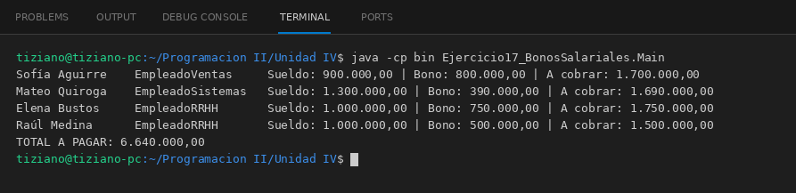

# TrabajadorCorporativo

Programación II - Unidad 4 - Ejercicio 17

## Consigna
Liquidar el bono anual de empleados de distintos sectores sin verificar la subclase.

## Lógica
- Clase abstracta `TrabajadorCorporativo` (nombre, sueldoBase) con `double calcularBonoAnual()`.
- `EmpleadoVentas` cobra 2 % de las ventas anuales, `EmpleadoSistemas` 10 % del sueldo por cada certificación y `EmpleadoRRHH` 50 % del sueldo más 25 % si cumplió el objetivo.
- `LiquidadorSueldos.liquidar(trabajador)` calcula sueldo + bono para cualquier `TrabajadorCorporativo`.
- `Main`: cuatro empleados y el total a pagar.

## Ejecución

